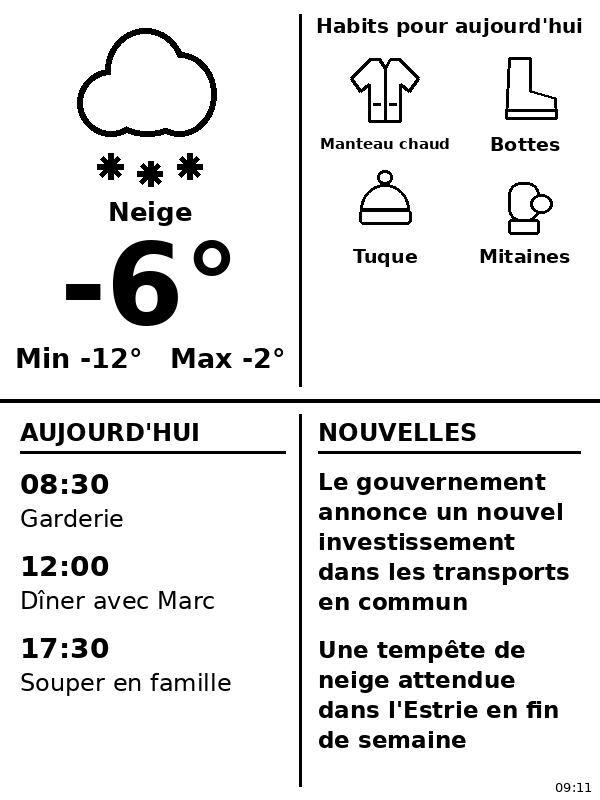

# Kobo e-ink dashboard

A small home dashboard for an old **Kobo Mini** (5" e-ink screen). A Raspberry Pi draws a
600×800 grayscale image in French (current weather, what the kids should wear, today's
calendar, top headlines) and the Kobo downloads and displays it on a schedule.

| Day | Night |
|---|---|
|  |  |

*(Previews are generated with fake data: `python3 server/dashboard.py out.png --demo`.)*

## Table of contents

1. [How it works](#how-it-works)
2. [Project status](#project-status)
3. [Repository layout](#repository-layout)
4. [Server setup (Raspberry Pi)](#server-setup-raspberry-pi)
5. [Configuration](#configuration)
6. [Kobo setup](#kobo-setup)
7. [Keeping the Kobo awake](#keeping-the-kobo-awake)
8. [Testing without the hardware](#testing-without-the-hardware)
9. [Troubleshooting](#troubleshooting)
10. [Roadmap](#roadmap)
11. [Credits](#credits)

## How it works

```
 Open-Meteo (weather)  ─┐
 News RSS feed         ─┼─►  Raspberry Pi            Kobo Mini
 Calendar (.ics, TODO) ─┘    server/dashboard.py ──► kobo/kobo_fetch.sh
                             draws dashboard.png     curl the PNG, show it with FBInk
                             (cron, every 30 min)    (loop, every 30 min)
```

The Kobo stays "dumb": it only downloads one finished image and draws it. All the logic
(weather, clothing rules, layout, French text) lives on the Pi, which is much easier to
change than anything running on a 2012 e-reader.

**Screen layout (600×800):**

- **Top half, left:** big weather icon (sun, moon at night, clouds, rain, snow, fog,
  storm), the condition in French, the current temperature, and the day's min/max.
- **Top half, right:** up to 6 clothing icons for the children. Before noon they are for
  today (based on the feels-like temperature); after noon they switch to tomorrow
  (based on the average of tomorrow's min and max).
- **Bottom half, left:** today's calendar events.
- **Bottom half, right:** the top 2 news headlines.

## Project status

| Part | Status |
|---|---|
| Image generator (layout, icons, French text, day/night) | Working, tested with demo data |
| Weather from Open-Meteo | Implemented, not yet verified end-to-end on the Pi |
| News headlines | Implemented, **RSS URL needs verification** |
| Calendar | **Placeholder only** (hardcoded dummy events) |
| Kobo fetch + display script | Written, needs on-device testing |
| Staying awake / scheduled wake-up | Keep-awake test script provided; RTC wake untested |

## Repository layout

```
kobo-dashboard/
├── README.md
├── docs/                     preview images used in this README
├── server/                   runs on the Raspberry Pi
│   ├── dashboard.py          fetches data, lays out and writes dashboard.png
│   ├── icons.py              hand-drawn weather and clothing icons
│   └── requirements.txt      Python dependencies
└── kobo/                     runs on the Kobo
    ├── kobo_fetch.sh         download the image (and optionally display it, or loop)
    └── kobo_loop_test.sh     display a local image in a loop to test that the Kobo stays awake
```

## Server setup (Raspberry Pi)

**1. Install dependencies** (Raspberry Pi OS):

```sh
sudo apt install python3-pil python3-requests fonts-dejavu-core
```

Or, with pip in a virtual environment: `pip install -r server/requirements.txt`
(you still need the DejaVu fonts: `fonts-dejavu-core`).

**2. Generate an image:**

```sh
python3 server/dashboard.py /home/pi/www/dashboard.png
```

**3. Serve it over plain HTTP** so the Kobo can fetch it. Plain HTTP on your home network
is deliberate: the old Kobo firmware may struggle with modern HTTPS certificates.

```sh
mkdir -p /home/pi/www
python3 -m http.server 8080 --directory /home/pi/www
```

Any web server works (nginx, Apache) if you prefer something permanent. To keep the Python
one running at boot, wrap it in a systemd service.

**4. Regenerate every 30 minutes** with cron (`crontab -e`):

```cron
*/30 * * * * /usr/bin/python3 /home/pi/kobo-dashboard/server/dashboard.py /home/pi/www/dashboard.png
```

The image is then reachable at `http://<pi-ip>:8080/dashboard.png`. Give the Pi a fixed IP
(or a reserved DHCP lease on your router) so this address never changes.

## Configuration

Everything is at the top of `server/dashboard.py` unless noted.

| Setting | Where | Notes |
|---|---|---|
| Location | `LAT`, `LON`, `TZ` | Defaults to Sherbrooke, Québec |
| News feed | `NEWS_RSS` | The default Radio-Canada URL is a best guess: **verify it**. Any RSS feed with `<item><title>` works |
| Number of headlines | `NB_TITRES` | Default 2 |
| Calendar events | `EVENEMENTS` | Dummy list of `("HH:MM", "title")` for now |
| Clothing rules | `clothes()` function | Thresholds: coat under 20°, boots and tuque under 5°, mittens under 0°, snow pants under -10°, umbrella if rain or 50%+ chance, sun hat if 25°+ and sunny |
| Icons | `server/icons.py` | All drawn with Pillow primitives in a 100×100 virtual box |
| Fonts | `FONT_CANDIDATES` | Tries a font next to the script, then Linux, Windows, macOS paths |

Weather data comes from [Open-Meteo](https://open-meteo.com/) (no API key). It returns a
standard WMO weather code and an `is_day` flag, which the script maps to an icon and a
French label.

## Kobo setup

Target device: **Kobo Mini (N705)**. The older Kobo Touch should work similarly.

**1. Update the firmware.** If the automatic update doesn't work on an old firmware, install
it manually: download the firmware package for your model from a Kobo firmware archive,
extract `KoboRoot.tgz`, copy it into the hidden `.kobo` folder on the device over USB, then
eject. It installs on reboot. Back up the `.kobo` folder first. (If you're on a very old
version, an intermediate firmware may be needed.)

**2. Install KOReader.** Follow the official instructions on the KOReader wiki:
<https://github.com/koreader/koreader/wiki/Installation-on-Kobo-devices>. KOReader provides
the launcher setup and the terminal emulator used below.

**3. Copy the scripts.** Create a folder on the device, for example `/mnt/onboard/dash/`,
and copy the contents of `kobo/` into it. The scripts keep the image in a `Dashboard/`
subfolder next to themselves.

**4. Test the display.** Put any 600×800 PNG at `dash/Dashboard/dashboard.png`, enable wifi
if you want, then run from KOReader's terminal emulator:

```sh
sh /mnt/onboard/dash/kobo_loop_test.sh
```

See [Keeping the Kobo awake](#keeping-the-kobo-awake) for how to read the result.

**5. Connect to the Pi.** Edit `URL` in `kobo_fetch.sh` (or use the `DASH_URL` variable) to
point to `http://<pi-ip>:8080/dashboard.png`, then:

```sh
sh /mnt/onboard/dash/kobo_fetch.sh        # download only
sh /mnt/onboard/dash/kobo_fetch.sh show   # download and display
sh /mnt/onboard/dash/kobo_fetch.sh loop   # every 30 minutes
```

Notes: the scripts assume `fbink` is bundled with KOReader at
`/mnt/onboard/.adds/koreader/fbink`, and fall back to any `fbink` in the `PATH`. If neither
exists, download a standalone FBInk build for Kobo from its GitHub releases.

## Keeping the Kobo awake

By default a Kobo suspends after a few minutes and only wakes on a button press or USB
plug-in. For a dashboard that refreshes on its own, there are three options:

1. **Stay awake and plugged in (recommended first version).** A loop fetches, draws, and
   sleeps. The e-ink screen holds the image with no power, so the idle cost is small.
2. **Wake with the hardware clock (RTC).** Program the RTC alarm, suspend, wake, refresh,
   repeat, for weeks of battery life. Untested on the Kobo Mini's old kernel.
3. **Manual refresh.** Wake it by hand when you want fresh data.

**Validating option 1:** run `kobo/kobo_loop_test.sh` for 30 minutes or more with the Kobo on
its charger. It redraws the image at each interval, prints a counter and timestamp at the
bottom of the screen, and appends to `test_loop.log`.

- If the counter matches elapsed time divided by the interval, it never slept.
- In the log, a gap between two lines larger than the interval means the device suspended.

If it suspends while running under KOReader, disable KOReader's own auto-suspend in its
settings and test again. The final setup should stop KOReader and the stock Kobo software
while the loop runs, since they have their own sleep logic and will fight over the screen
and wifi.

## Testing without the hardware

The generator has a demo mode that needs no network, useful on any computer:

```sh
python3 server/dashboard.py test.png --demo --temp -14 --code 71 --hour 9
```

| Flag | Meaning |
|---|---|
| `--demo` | Use fake weather and news instead of fetching |
| `--temp N` | Fake current temperature in °C |
| `--code N` | Fake WMO weather code (0 clear, 2 partly cloudy, 3 overcast, 61 rain, 71 snow, 95 storm) |
| `--hour N` | Force the hour (before 12 shows today's clothing, 12+ shows tomorrow's) |
| `--night` | Force night (moon icon) |

## Troubleshooting

- **Tiny text or broken accents (`d▯gag▯`):** the script couldn't find a TrueType font and
  fell back to Pillow's built-in bitmap font. It prints a warning. On Windows it should find
  Arial automatically; otherwise put `DejaVuSans.ttf` and `DejaVuSans-Bold.ttf` next to
  `dashboard.py`.
- **"Météo indisponible" or "Nouvelles indisponibles" on the image:** the Pi couldn't reach
  Open-Meteo or the RSS feed. The script logs the exact error to stderr. For news, check
  `NEWS_RSS`.
- **`fbink introuvable` on the Kobo:** see the note in [Kobo setup](#kobo-setup).
- **Download fails on the Kobo:** check wifi, that the Pi's address is reachable from the
  Kobo (`curl` it from the terminal), and prefer plain `http://` over `https://`.
- **KOReader redraws over the image:** expected while KOReader owns the screen. It matters
  only for testing; the final setup stops it.
- **The image is stale:** check the small clock in the bottom-right corner, then the cron
  job on the Pi.

## Roadmap

- Real calendar: read a private `.ics` URL (Google Calendar, Outlook) on the Pi and show
  today's events.
- Verify and fix the news RSS feed; maybe pick headlines more carefully.
- Run the Kobo loop without KOReader and the stock software, with wifi on/off handling.
- Try RTC wake for battery operation.
- Optional: swap the hand-drawn weather icons for an icon set (e.g. the Weather Icons font)
  if the current ones aren't polished enough.
- Other ideas: sunrise/sunset, school closure or snow alerts, a countdown to an event.

## Credits

- Weather data: [Open-Meteo](https://open-meteo.com/)
- E-ink drawing: [FBInk](https://github.com/NiLuJe/FBInk)
- Reader software and launcher: [KOReader](https://github.com/koreader/koreader)
- Fonts: DejaVu Sans
