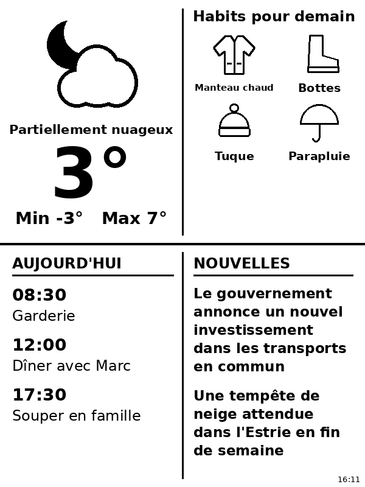

# Kobo e-ink dashboard

A small home dashboard for an old **Kobo Mini** (5" e-ink screen). A Raspberry Pi draws a
600×800 grayscale image in French (current weather, what the kids should wear, today's
calendar, top headlines) and the Kobo downloads and displays it on a schedule.

| Day | Night |
|---|---|
|  |  |

*(The previews use sample data; real headlines and events come from your own config.)*

## Table of contents

1. [How it works](#how-it-works)
2. [Project status](#project-status)
3. [Repository layout](#repository-layout)
4. [Example values used in this README](#example-values-used-in-this-readme)
5. [Server setup (Raspberry Pi + nginx)](#server-setup-raspberry-pi--nginx)
6. [Configuration](#configuration)
7. [Kobo setup](#kobo-setup)
8. [Running it like an app (KFMon launcher)](#running-it-like-an-app-kfmon-launcher)
9. [Keeping the Kobo awake](#keeping-the-kobo-awake)
10. [Troubleshooting](#troubleshooting)
11. [Roadmap](#roadmap)
12. [Credits](#credits)

## How it works

```
 Open-Meteo (weather)  ─┐
 News RSS feed         ─┼─►  Raspberry Pi                       Kobo Mini
 Calendar (.ics URL)   ─┘    server/dashboard.py                kobo/kobo_fetch.sh
                             writes output/dashboard.png  ──►    curl the PNG, show it with FBInk
                             (cron, every 30 min)                (loop, every 30 min)
                             nginx serves that one file
```

The Kobo stays "dumb": it only downloads one finished image and draws it. All the logic
(weather, clothing rules, layout, French text) lives on the Pi, which is much easier to
change than anything running on a 2012 e-reader.

**Screen layout (600×800):**

- **Header:** a title ("Panneau Castor" by default) with, in small text on the right, when
  the image was last updated (for example "12 nov. à 11:00"), which makes a stale image easy
  to spot.
- **Weather block, left:** big weather icon (sun, moon at night, clouds, rain, snow, fog,
  storm), the condition in French, the current temperature, and the day's min/max.
- **Weather block, right:** up to 6 clothing icons for the children. Before noon they are for
  today (based on the feels-like temperature); from noon on they switch to tomorrow
  (based on the average of tomorrow's min and max).
- **Bottom block, left:** today's calendar events that are not over yet (all-day events
  first), in a compact two-line format. Shows "+ N autres" when they don't all fit, and
  "Calendrier non configuré" if no calendar URL is set.
- **Bottom block, right:** the top news headline(s) in regular type, as many as fit.

If a data source fails (no network, bad URL), that block shows a short French message
("Météo indisponible", "Nouvelles indisponibles", "Calendrier indisponible") instead of
breaking the whole image, and the error is printed to stderr.

## Project status

| Part | Status |
|---|---|
| Image generator (layout, icons, French text, day/night) | Working, tested with simulated data |
| Weather (Open-Meteo) | Implemented; not yet verified end-to-end on the Pi |
| News headlines | Implemented; the default Radio-Canada feed is listed as working by a third-party feed aggregator, not yet tested from the Pi |
| Calendar (.ics) | Implemented (recurring events, all-day events, time zones); tested only with synthetic calendars, not yet with a real Google/Outlook one |
| Kobo fetch + display script | Working from KOReader's terminal (download and display tested on the Kobo Mini) |
| KFMon launcher (icon in the library) | Written, **not yet tested on a Kobo**: wifi behaviour and screen orientation once Nickel is stopped are the open questions |
| Staying awake / scheduled wake-up | Keep-awake test script provided; RTC wake untested |

## Repository layout

```
kobo_dashboard/
├── README.md
├── config.example.ini        template for your private config (copy to config.ini)
├── config.ini                YOUR config: not committed (.gitignore)
├── output/                   generated image and log: not committed (.gitignore)
│   └── dashboard.png
├── docs/                     preview images used in this README
├── server/                   runs on the Raspberry Pi
│   ├── dashboard.py          entry point: fetches data, lays out, writes the image
│   ├── config.py             loads config.ini
│   ├── calendar_events.py    reads an .ics URL, returns today's events
│   ├── check_calendar.py     diagnostic: shows what the .ics contains and what gets displayed
│   ├── draw_utils.py         fonts, text fitting and wrapping helpers
│   ├── icons.py              hand-drawn weather and clothing icons
│   └── requirements.txt      Python dependencies
└── kobo/                     runs on the Kobo
    ├── kobo_fetch.sh         download the image, display it, or loop (with a log)
    ├── dashboard.conf.example  settings for the Kobo scripts (copy to dashboard.conf)
    ├── dashboard.sh          KFMon launcher: stops Nickel, runs the loop, reboots at the end
    └── kfmon/
        ├── dashboard.ini     KFMon watch config (makes the library icon launch the dashboard)
        └── panneau.png       the icon that shows up in the Kobo library
```

## Example values used in this README

So that the commands can be copy-pasted as they are, the README assumes:

| What | Example value |
|---|---|
| Raspberry Pi address | `192.168.1.135` |
| Pi user | `pi` |
| Project folder on the Pi | `/home/pi/kobo_dashboard` |
| Location | Montréal (`45.5017`, `-73.5673`) |

Replace them with your own where they differ. Give the Pi a fixed IP (or a reserved DHCP
lease on your router) so its address never changes.

## Server setup (Raspberry Pi + nginx)

This assumes nginx is already installed and running on the Pi. The generated image always
stays inside the project folder (`output/dashboard.png`); nginx just serves that one file.

**1. Get the project onto the Pi** (replace the URL with your repository's):

```sh
cd /home/pi
git clone https://github.com/YOUR_USER/kobo_dashboard.git
cd kobo_dashboard
```

**2. Install dependencies.** Pillow and requests come from apt (reliable on Raspberry Pi
OS), the rest from pip inside a virtual environment that can see the apt packages:

```sh
sudo apt install python3-pil python3-requests fonts-dejavu-core
python3 -m venv --system-site-packages .venv
.venv/bin/pip install -r server/requirements.txt
```

**3. Create your config** from the template and edit it (see
[Configuration](#configuration)):

```sh
cp config.example.ini config.ini
nano config.ini
```

**4. Generate the image once** to check that everything works:

```sh
.venv/bin/python server/dashboard.py
```

This writes `/home/pi/kobo_dashboard/output/dashboard.png`. Open it (for example copy it
to your computer with `scp`) to check how it looks.

**5. Add a small nginx server block for the Kobo.** If your existing sites are HTTPS-only
(for example with Certbot and a redirect from port 80), don't put the `location` inside
those blocks: the Kobo would get redirected to HTTPS, and Certbot manages those blocks.
Add a separate `server { }` block instead, in the same file, **after** the existing ones
and at the same level (not inside another block):

```nginx
server {
    listen 80;
    server_name 192.168.1.135;

    # Only allow devices on the home network
    allow 192.168.1.0/24;
    deny all;

    location = /dashboard.png {
        alias /home/pi/kobo_dashboard/output/dashboard.png;
        add_header Cache-Control "no-store";
    }

    location / {
        return 404;
    }
}
```

Then check the configuration, reload, and test:

```sh
sudo nginx -t && sudo systemctl reload nginx
curl -I http://192.168.1.135/dashboard.png
```

You should get `HTTP/1.1 200 OK` with `Content-Type: image/png`.

- nginx picks the server block from the host name in the request, so requests to
  `192.168.1.135` land here, while your domain keeps going to its own HTTPS blocks.
- The `allow`/`deny` lines restrict the image to your home network (adjust
  `192.168.1.0/24` to your range). This matters if your domain is public, since the image
  shows your calendar events.
- `no-store` tells caches to always fetch the latest image, and `location / { return 404; }`
  keeps nginx from serving a default page on that address.
- A `location` directive outside a `server { }` block makes nginx fail with
  `"location" directive is not allowed here`.

If you get **403 Forbidden**, nginx (user `www-data`) can't traverse your home directory.
Allow it to pass through (without being able to list files):

```sh
chmod o+x /home/pi
```

**6. Regenerate the image every 30 minutes** with cron. This command adds the job without
opening an editor:

```sh
(crontab -l 2>/dev/null; echo '*/30 * * * * /home/pi/kobo_dashboard/.venv/bin/python /home/pi/kobo_dashboard/server/dashboard.py >> /home/pi/kobo_dashboard/output/dashboard.log 2>&1') | crontab -
```

Errors (unreachable weather service, bad calendar URL, …) end up in
`output/dashboard.log`. The image is written atomically, so nginx never serves a
half-written file.

## Configuration

All your personal values live in **`config.ini`** at the project root. It is listed in
`.gitignore`, so it never gets committed. The committed template is `config.example.ini`
(with Montréal as the example location). The file is read each time the image is
generated, so changes apply on the next run.

| Section | Key | Meaning |
|---|---|---|
| `[location]` | `latitude`, `longitude` | Where the weather is for |
| `[location]` | `timezone` | IANA time zone name, e.g. `America/Toronto` (also used to decide "today" and the noon switch) |
| `[news]` | `feed_url` | RSS feed of headlines. Empty shows "Nouvelles non configurées" |
| `[news]` | `headlines` | How many headlines to show (default 1; shows as many as fit, the last one may be truncated) |
| `[display]` | `title` | Title in the header (default "Panneau Castor") |
| `[calendar]` | `ics_url` | Private iCal (.ics) address. Empty shows "Calendrier non configuré" |

**Calendar URL:** in Google Calendar, use *Settings → your calendar → Integrate calendar →
"Secret address in iCal format"*. Anyone with that address can read your calendar, so treat
it like a password. This is exactly why it belongs in `config.ini` and never in the repo. If it
ever leaks (pasted in a chat, committed by mistake), reset it from the same screen in Google
Calendar (the *Reset* button next to the secret address) and put the new one in `config.ini`.
`webcal://` addresses are accepted.

**Other settings live in the code:**

| Setting | Where | Notes |
|---|---|---|
| Clothing rules | `clothes()` in `server/dashboard.py` | Coat under 20°, boots and tuque under 5°, mittens under 0°, snow pants under -10°, umbrella if rain or 50%+ chance, sun hat if 25°+ and sunny |
| Noon switch | `now.hour >= 12` in `draw_weather()` | When clothing icons switch to tomorrow |
| Icons | `server/icons.py` | Drawn with Pillow primitives in a 100×100 virtual box |
| Fonts | `FONT_CANDIDATES` in `server/draw_utils.py` | Tries a font next to the script, then Linux, Windows, macOS paths |

Weather data comes from [Open-Meteo](https://open-meteo.com/) (no API key). It returns a
standard WMO weather code and an `is_day` flag, which the script maps to an icon and a
French label.

## Kobo setup

Target device: **Kobo Mini (N705)**. The older Kobo Touch should work similarly.

**1. Update the firmware.** If the automatic update doesn't work on an old firmware, install
it manually: download the firmware package for your model from a Kobo firmware archive,
extract `KoboRoot.tgz`, copy it into the hidden `.kobo` folder on the device over USB, then
eject. It installs on reboot. Back up the `.kobo` folder first. (If you're on a very old
version, an intermediate firmware may be needed.)

**2. Install KOReader.** Follow the official instructions on the KOReader wiki:
<https://github.com/koreader/koreader/wiki/Installation-on-Kobo-devices>. KOReader provides
the launcher setup and the terminal emulator used below.

**3. Copy the files.** Create a folder on the device, for example `/mnt/onboard/.adds/dash/` (a
hidden `.adds` folder, so that Nickel doesn't import the downloaded image into your library as a
"book"), and copy into it `kobo_fetch.sh` and a copy of `dashboard.conf.example` renamed to
`dashboard.conf`. The script saves the image as `dashboard.png` right next to itself, and the
loop keeps a log (`fetch.log`) there too.

**4. Edit `dashboard.conf`.** It already points to `http://192.168.1.135/dashboard.png` and
refreshes every 5 minutes, which is handy for testing (use 1800 for 30 minutes in everyday
use). If your Pi has another address, change `DASH_URL`. Environment variables with the same
names override the file, for example `DASH_INTERVAL=60 sh kobo_fetch.sh loop`.

**5. Run it** from KOReader's terminal emulator, with wifi on:

```sh
sh /mnt/onboard/.adds/dash/kobo_fetch.sh        # download only
sh /mnt/onboard/.adds/dash/kobo_fetch.sh show   # download and display
sh /mnt/onboard/.adds/dash/kobo_fetch.sh loop   # download and display, again and again
```

Running from KOReader's terminal is meant for testing: KOReader keeps owning the screen and may
repaint parts of itself over the image. The launcher below avoids that.

Plain `http://` is deliberate: the old Kobo firmware may struggle with modern HTTPS
certificates, and this only travels over your home network.

**FBInk with image support.** The scripts draw the image with the `fbink` command, taken from
the `PATH` (normally `/usr/bin/fbink`). To use another binary:
`FBINK=/path/to/fbink sh kobo_fetch.sh show`. It must be a **full** FBInk build: the one
bundled with KOReader is a "minimal" build and fails with *"image support is disabled in this
fbink build"*. To install a full one:

- Get the Kobo package from NiLuJe's FBInk thread on MobileRead
  (<https://www.mobileread.com/forums/showthread.php?t=299110>), or from the FBInk releases
  on GitHub (<https://github.com/NiLuJe/FBInk/releases>), and follow the install
  instructions there (copy `KoboRoot.tgz` into `.kobo`, eject).
- **Restart the Kobo** afterwards: the install only takes effect on reboot.
- Check with `which fbink`.

## Running it like an app (KFMon launcher)

A launcher turns the dashboard into an icon in the Kobo library: open it and the dashboard takes
over the screen, with no terminal. It relies on [KFMon](https://github.com/NiLuJe/kfmon), which
you already have if you installed KOReader with the one-click package. KFMon watches for a
special "book" (a PNG icon) in the library and runs a program when you open it.

**What happens when you open the icon:** KFMon runs `dashboard.sh`, which (1) syncs the disk,
(2) stops Nickel, the stock Kobo software, using the same list of processes as KOReader's own
launcher, (3) runs `kobo_fetch.sh loop`, and (4) reboots the Kobo when the loop ends, so it comes
back to normal. With Nickel stopped, nothing puts the Kobo to sleep or draws over the image.
KFMon stays running and refuses a second launch in the meantime.

**Setup:**

1. Copy `kobo_fetch.sh`, `dashboard.sh` and `dashboard.conf` into `/mnt/onboard/.adds/dash/`
   (see [Kobo setup](#kobo-setup)).
2. Copy `kobo/kfmon/panneau.png` to `/mnt/onboard/icons/` (create the folder if needed). It has to
   be in a *visible* folder so that Nickel imports it into the library.
3. Copy `kobo/kfmon/dashboard.ini` to `/mnt/onboard/.adds/kfmon/config/`.
4. Eject the Kobo. KFMon picks up new watch configs after a USB session, and Nickel imports the
   icon: a "panneau" entry appears in your library (to give it the title "Panneau Castor", set
   `do_db_update = 1` in `dashboard.ini`, which writes to Nickel's database: it's off by default
   because that is a bit risky).
5. Turn wifi on in Nickel **before** opening the icon: it stays on once Nickel is stopped.

**For your first tries,** set `DASH_MAX_LOOPS=3` in `dashboard.conf`: after three rounds the
launcher reboots the Kobo by itself, so you can't get stuck.

**Getting out:** wait for `DASH_MAX_LOOPS` to run out, or hold the power button until the LED
blinks rapidly, which forces a reboot (this is how the TRMNL-for-Kobo project describes leaving its
loop; the LED is blue on a Kobo Mini). To uninstall, delete `dashboard.ini` from KFMon's config
folder and the icon from `icons/`.

**Logs:** `launcher.log` (start-up, network interfaces, end) and `fetch.log` (one line per round)
in `/mnt/onboard/.adds/dash/`.

**What isn't verified yet:** I haven't been able to run this on a real Kobo Mini. The points to
check on your device are whether wifi really stays up once Nickel is stopped (the author of KFMon
says it does when it was on beforehand), whether the image keeps the right orientation, and whether
the Kobo then stays awake (`fetch.log` shows gaps if it doesn't). Tell me what `launcher.log` says
if something goes wrong.

## Keeping the Kobo awake

By default a Kobo suspends after a few minutes and only wakes on a button press or USB
plug-in. For a dashboard that refreshes on its own, there are three options:

1. **Stay awake and plugged in (recommended first version).** A loop fetches, draws, and
   sleeps. The e-ink screen holds the image with no power, so the idle cost is small. With the
   [KFMon launcher](#running-it-like-an-app-kfmon-launcher), Nickel is stopped, so nothing
   suspends the device (to be confirmed on your Kobo with `fetch.log`).
2. **Wake with the hardware clock (RTC).** Program the RTC alarm, suspend, wake, refresh,
   repeat, for weeks of battery life. Untested on the Kobo Mini's old kernel.
3. **Manual refresh.** Wake it by hand when you want fresh data.

**Validating option 1:** run the loop with a short interval for 30 minutes or more, with the
Kobo on its charger and without touching the screen:

```sh
DASH_INTERVAL=60 sh /mnt/onboard/.adds/dash/kobo_fetch.sh loop
```

Each round downloads and redraws the image, then appends a line to `fetch.log` next to the
script (the last 500 lines are kept). A gap between two lines larger than the interval means
the device suspended, and a "téléchargement échoué" or "affichage échoué" line tells you why
nothing changed. The Pi must be reachable, since every round downloads the image.

If it suspends while running from KOReader's terminal, disable KOReader's own auto-suspend in its
settings and test again. The launcher doesn't have this problem, since neither KOReader nor
Nickel is running.

## Troubleshooting

- **`ModuleNotFoundError: No module named 'icalendar'` (or another module), e.g. on
  Windows:** dependencies aren't installed. Run `py -m pip install -r server\requirements.txt`
  (the `apt` commands are for the Pi only). `icalendar` is only needed when a calendar URL is
  set in `config.ini`.
- **`Fichier de configuration introuvable`:** you haven't created `config.ini`. Run
  `cp config.example.ini config.ini`.
- **`Configuration invalide` or `Fuseau horaire inconnu`:** check the keys and values in
  `config.ini` against `config.example.ini`. On Windows, time zones need
  `pip install tzdata` (included in `requirements.txt`).
- **Tiny text or broken accents (`d▯gag▯`):** the script couldn't find a TrueType font and
  fell back to Pillow's built-in bitmap font. It prints a warning. On Windows it should find
  Arial automatically; otherwise put `DejaVuSans.ttf` and `DejaVuSans-Bold.ttf` in `server/`.
- **"Météo indisponible", "Nouvelles indisponibles" or "Calendrier indisponible" on the
  image:** the Pi couldn't reach that source or couldn't read it. The exact error is in
  `output/dashboard.log` (or on screen if you ran the script by hand).
- **The calendar says "Rien de prévu" but you have events:** run the diagnostic, which shows
  what the calendar file contains and why each event is or isn't displayed:

  ```sh
  /home/pi/kobo_dashboard/.venv/bin/python /home/pi/kobo_dashboard/server/check_calendar.py
  ```

  The usual causes: today's events are **already over** (finished events are hidden, so in the
  evening you often see "Rien de prévu"), the event was added very recently (Google can take
  hours to update a secret `.ics` feed), or it is on another calendar than the one whose
  address you configured. The diagnostic never prints the full URL.
- **"Calendrier non configuré" / "Nouvelles non configurées":** `ics_url` / `feed_url` is
  empty in `config.ini`.
- **nginx returns 404:** `output/dashboard.png` doesn't exist yet (run the script once), or
  the `alias` path doesn't match your install folder.
- **nginx returns 403:** see the `chmod o+x /home/pi` step above.
- **"image support is disabled in this fbink build" on the Kobo:** the fbink in use is a
  minimal build. Install a full one (and restart the Kobo), see "FBInk with image support"
  in [Kobo setup](#kobo-setup).
- **`fbink introuvable`:** no `fbink` in the `PATH`. See the same section, or point to it with
  the `FBINK` variable.
- **The terminal draws over the image (after `show`, or around it in `loop`):** expected, since
  KOReader's terminal shares the screen. The `loop` mode keeps its messages out of the terminal
  (they go to `fetch.log`), but KOReader may still repaint itself. Use the
  [KFMon launcher](#running-it-like-an-app-kfmon-launcher), which runs without KOReader.
- **Nothing happens when I open the icon:** check that `dashboard.ini` is in
  `/mnt/onboard/.adds/kfmon/config/`, that `filename` matches the icon's real path and
  `action` the real path of `dashboard.sh` (128 characters maximum each), and that the Kobo was
  ejected from the computer afterwards. If `launcher.log` exists, the launcher did start: read it.
- **Download fails on the Kobo:** check wifi, and test the address from the Kobo's terminal
  with `curl -I http://192.168.1.135/dashboard.png`.
- **KOReader redraws over the image:** expected while KOReader owns the screen. It matters
  only for testing; the final setup stops it.
- **The image is stale:** check the "Mis à jour" stamp in the header, then the cron job and
  `output/dashboard.log` on the Pi.

## Roadmap

- Test the calendar against a real Google Calendar / Outlook `.ics` feed.
- Validate the KFMon launcher on a real Kobo Mini (wifi, orientation, staying awake), then handle
  wifi on/off between rounds.
- Try RTC wake for battery operation.
- Optional: swap the hand-drawn weather icons for an icon set (e.g. the Weather Icons font)
  if the current ones aren't polished enough.
- Other ideas: sunrise/sunset, school closure or snow alerts, a countdown to an event.

## Credits

- Weather data: [Open-Meteo](https://open-meteo.com/)
- E-ink drawing: [FBInk](https://github.com/NiLuJe/FBInk)
- Reader software and launcher: [KOReader](https://github.com/koreader/koreader)
- Calendar parsing: [icalendar](https://pypi.org/project/icalendar/) and
  [recurring-ical-events](https://pypi.org/project/recurring-ical-events/)
- Fonts: DejaVu Sans
